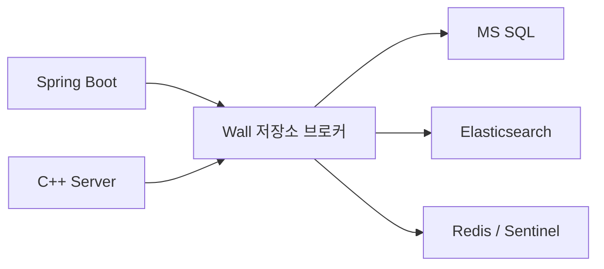

# 저장소 브로커

Spring·C++가 MS SQL, Elasticsearch, Redis에 접근할 때 Wall의 `agora-storage-broker`를 경유합니다. HAProxy의 TCP 중계를 사용하여 JDBC/TDS·HTTPS·RESP 드라이버와 연결 풀을 유지합니다. Phoenix는 사용자 WebSocket 라우팅과 인증을, 저장소 브로커는 저장소 연결 중계를 담당합니다.



## 네트워크와 TLS

- Spring·C++·Phoenix는 `agora-services`에만 연결됩니다. Nginx는 `agora-services`와 FE의 `agora-web`에 연결됩니다.
- 저장소 브로커만 `agora-services`, SQL/ES의 `agora-net`, Redis의 `agora-redis-ha`를 함께 사용합니다. 기본 서비스 서브넷은 `172.23.0.0/16`이며 저장소 서브넷과 겹칠 수 없습니다.
- 브로커에는 공개 포트, DB 비밀번호, 개인 키가 없습니다. TLS 스트림을 복호화하지 않고 그대로 전달합니다. 저장소 인증과 CA·SAN 검증은 기존 드라이버가 수행합니다.
- Redis·Elasticsearch 연결은 TLS 1.3이며 현재 SQL Server 2022 Linux 연결은 TLS 1.2입니다. TDS pre-login과 이후 TLS 핸드셰이크도 같은 연결에서 전달합니다.
- 기본 최대 연결은 전체 4096개, SQL/ES/Redis 노드별 512개, Sentinel별 256개입니다. 연결 대기 제한은 30초, 유휴 연결 제한은 1시간입니다. HAProxy의 backend TCP 상태 검사는 포트 도달성 검사이며 자격 증명·쿼리 성공을 보증하지 않습니다.

## 라우팅

| 클라이언트 주소 | 브로커 포트 | 저장소 upstream 설정 |
| --- | --- | --- |
| `agora-mssql:1433` | `1433` | `STORAGE_MSSQL_UPSTREAM` |
| `agora-elasticsearch:9200` | `9200` | `STORAGE_ES_UPSTREAM` |
| Redis 최초 primary | `16379` | `STORAGE_REDIS_PRIMARY_UPSTREAM` |
| Redis replica 1 | `16380` | `STORAGE_REDIS_REPLICA_1_UPSTREAM` |
| Redis replica 2 | `16381` | `STORAGE_REDIS_REPLICA_2_UPSTREAM` |
| Sentinel 1/2/3 | `26379`/`26380`/`26381` | `STORAGE_SENTINEL_1/2/3_UPSTREAM` |

SQL·ES의 기존 호스트명은 서비스 네트워크에서 브로커의 별칭으로 해석됩니다. 브로커의 저장소 쪽 대상은 고유 이름인 `mssql:1433`, `elasticsearch:9200`을 사용합니다. upstream에 브로커 자신의 클라이언트 별칭을 넣으면 순환 연결이 생기므로 사용하지 않습니다. 실제 AG listener나 다른 저장소로 바꿀 때는 Wall upstream과 해당 저장소 인증서의 클라이언트 호스트명 SAN을 맞추세요.

Redis Sentinel 응답은 원래 노드 주소를 유지합니다. Spring·C++는 `REDIS_BROKER_ROUTES`의 허용 목록으로 실제 접속 주소만 `agora-storage-broker`와 전용 포트로 바꾸고, TLS 검증에는 원래 Redis/Sentinel 주소를 사용합니다. Sentinel의 새 primary 선택 및 `ROLE` 확인은 계속 수행됩니다. 등록되지 않은 주소나 잘못된 매핑은 연결 실패로 처리하며 직접 저장소로 우회하지 않습니다.

BE의 `setup-docker.py`/`sync-docker-env.py`가 현재 DB 설정으로 매핑을 생성합니다. Wall의 초기 `setup.py` 및 `storage-broker-docker.sh up`이 같은 매핑으로 upstream을 동기화합니다. Redis 노드를 추가할 때는 HAProxy listener·upstream과 BE 허용 목록을 함께 추가해야 합니다. 현재 기본 구성은 데이터 노드 3개와 Sentinel 3개입니다.

## 실행과 기존 구성 전환

전체 초기 설정은 FE의 `scripts/setup-projects.py`를 사용합니다. 저장소를 먼저 실행·초기화한 다음 다음 순서로 실행합니다.

```bash
cd ../project-agora-Wall
./scripts/storage-broker-docker.sh up
cd ../project-agora-BE
./scripts/backend-docker.sh up
cd ../project-agora-Wall
./scripts/broker-docker.sh up
./scripts/nginx-docker.sh development
```

BE의 `start-docker-stack.sh`도 DB 초기화 다음에 저장소 브로커를 시작합니다. 먼저 Wall `.env`를 준비해야 합니다. 별도 checkout 경로는 `AGORA_WALL_DIR`(BE 실행 도구), `AGORA_BE_DIR`(Wall 실행 도구)로 지정합니다.

기존 서비스는 BE의 매핑을 동기화하고 Wall의 저장소 브로커를 시작한 뒤 Spring·C++·Phoenix·Nginx를 재생성해야 네트워크 분리가 반영됩니다. Nginx의 기본 고정 IP는 `172.23.0.250`으로 변경되며 초기 설정은 기존 기본값과 C++ 신뢰 IP를 함께 갱신합니다. 저장소와 데이터 볼륨은 이동하거나 삭제하지 않습니다.

현재 브로커는 한 인스턴스입니다. 연결이 끊기면 드라이버가 재접속하며, 브로커 자체의 무중단 이중화는 별도 구성입니다.

## 검증

C++ `BUILD_TESTING=ON` 빌드에는 `agora_cpp_storage_broker_fixture`가 포함됩니다. 테스트 빌드와 런타임 라이브러리가 준비된 Docker 이미지 및 빌드 볼륨을 지정해 검증합니다.

```bash
python3 scripts/test-storage-broker.py \
  --cpp-test-image <C++-test-environment-image> \
  --cpp-build-volume <CMake-build-volume>
```

빌드 볼륨 루트에 fixture 실행 파일이 있어야 합니다. 도구는 네트워크 차단 검사에 `python:3.14-alpine` 이미지를 사용합니다. 임시 서비스 네트워크와 브로커를 생성하여 C++의 SQL `SELECT 1`, Redis/Sentinel 접속·`PING`, Elasticsearch 인덱스 `_count`를 검증하고 원래 저장소 주소로의 직접 접속이 차단되는지 확인합니다. 기존 서비스는 재시작하지 않고 임시 컨테이너·네트워크·비밀 환경 파일을 정리합니다.
